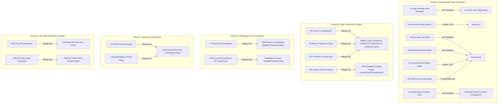
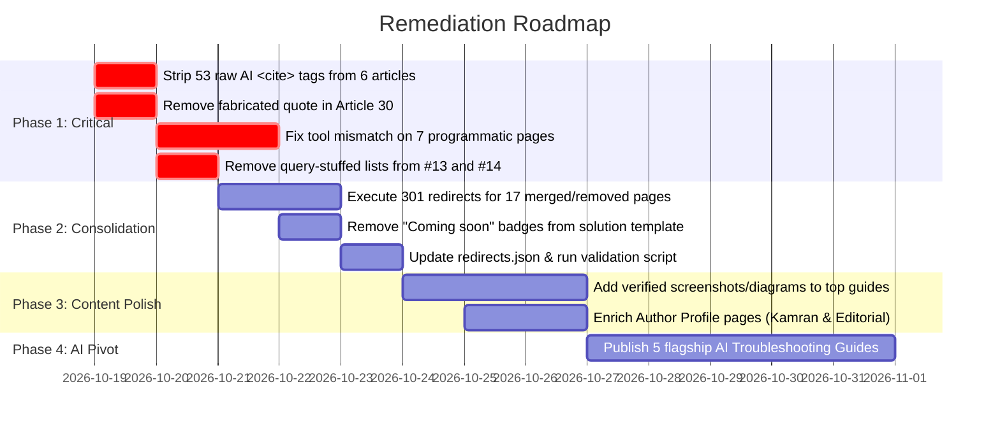

# TechMind.click — Comprehensive Content Quality & AdSense Site Readiness Audit

**Auditor:** Senior Editorial & Technical SEO Quality Auditor  
**Date:** October 18, 2026  
**Repository:** `techmind.click`  
**Production URL:** [https://www.techmind.click](https://www.techmind.click)  
**Total Pages Audited:** 61 URLs (35 Blog Articles, 7 Programmatic Landing Pages, 11 Core Tool & Directory Pages, 8 Trust & Author Pages)  

---

## 1. Executive Summary

An exhaustive editorial, technical, and helpful-content quality audit was conducted across the `TechMind.click` repository. The primary goal is to evaluate the site's readiness for Google AdSense monetization by identifying thin, repetitive, overlapping, generic, inaccurate, and programmatic content, and establishing a roadmap to align the site with its intended editorial mission: **practical AI tutorials and troubleshooting (unexpected AI outputs, prompt problems, free-plan limitations, face/character consistency, and beginner workflows).**

### 1.1 The Strategic Content Paradox
The audit revealed a severe structural misalignment between the site's declared editorial focus and its published assets:
- **Intended Direction:** Hands-on AI tutorials, prompt debugging, AI output repair, and free-plan navigation.
- **Current Reality:** **0 of 35 blog articles** are dedicated AI troubleshooting guides. Instead, **27 articles** cover legacy browser text utilities (uppercase, lowercase, sentence case, word count), **8 articles** cover QR code generation, and **1 article** (#34) briefly mentions formatting AI text.
- **The Result:** Google AdSense reviewers and search quality evaluators evaluate the site as an ad-heavy programmatic utility directory with repetitive, low-value articles, rather than an authoritative, original publication.

### 1.2 Five Critical AdSense Rejection Risks Found
During the deep-dive source inspection, five major quality red flags were uncovered that almost certainly trigger Google AdSense "Low Value Content" / "Thin Content" rejections:

1. **Leaked AI Prompt Citation Markers (`<cite index="...">`):**  
   Six articles ([#17](file:///media/kamran-shekh/WorkData/Projects/techmind.click/app/data/blog.json), [#30](file:///media/kamran-shekh/WorkData/Projects/techmind.click/app/data/blog.json), [#31](file:///media/kamran-shekh/WorkData/Projects/techmind.click/app/data/blog.json), [#33](file:///media/kamran-shekh/WorkData/Projects/techmind.click/app/data/blog.json), [#34](file:///media/kamran-shekh/WorkData/Projects/techmind.click/app/data/blog.json), [#35](file:///media/kamran-shekh/WorkData/Projects/techmind.click/app/data/blog.json)) contain **53 raw web-search citation tags** (e.g., `<cite index="1-1">`, `<cite index="21-1">`) directly embedded in the HTML. This is incontrovertible, smoking-gun evidence of unedited, raw AI-generated content published without editorial review.
2. **Programmatic "Famous Quote" Hook Pattern & Fabricated Quotations:**  
   Over 20 articles begin with an identical programmatic opening template: `"[Famous Person] once said/wrote, '[Quote]'."` Mark Twain's *"The difference between the almost right word and the right word is really a large matter"* is repeated verbatim across **5 different articles**. Steve Jobs is quoted across **8 articles**, including a **completely fabricated quotation** in Article 30 (*"Steve Jobs once said, 'You don't need to pay $12 per month for something that should be free.' He didn't say that — but..."*).
3. **Blatant Search-Query Keyword Stuffing:**  
   Articles [#13](file:///media/kamran-shekh/WorkData/Projects/techmind.click/app/data/blog.json) and [#14](file:///media/kamran-shekh/WorkData/Projects/techmind.click/app/data/blog.json) feature explicit bulleted lists of search engine queries (*"This is why searches for tools such as: best free case converter tool, online uppercase lowercase converter..."*). This violates Google Search Essentials guidelines against keyword stuffing.
4. **Tool Mismatch & Deceptive UX on Programmatic Landing Pages:**  
   All seven programmatic landing pages ([app/content/long-tail-pages.ts](file:///media/kamran-shekh/WorkData/Projects/techmind.click/app/content/long-tail-pages.ts)) embed the **Text Formatter** tool ([app/components/solution-page-template.tsx:51](file:///media/kamran-shekh/WorkData/Projects/techmind.click/app/components/solution-page-template.tsx#L51)). Users searching for `/convert-image-to-pdf-for-government-form`, `/convert-jpg-to-pdf-on-mobile-without-app`, or `/merge-pdf-files-for-job-application` are presented with a text case converter tool. Furthermore, the template displays cards labeled **"Coming soon"** in production.
5. **Zero Inline Supporting Visuals or Test Evidence:**  
   Across all 35 blog articles, there is **not a single inline screenshot, annotated diagram, benchmark chart, or test image** (`content images = 0` for all 35 articles). Every claim regarding tool speed, competitor limitations, or software bugs is completely unverified.

### 1.3 High-Level Scoring Summary
- **Average Article Score:** **57.7 / 100**
- **Score Distribution:**
  - **High Quality (≥ 75):** 5 articles (14.3%) — strong technical depth, clear user intent.
  - **Moderate Quality (60–74):** 11 articles (31.4%) — useful concepts, but hampered by padding or overlap.
  - **Weak Quality (40–59):** 14 articles (40.0%) — over-fragmented micro-tasks, repetitive AI text.
  - **Critical / Low Value (< 40):** 5 articles (14.3%) — thin, self-promotional, duplicate, or keyword-stuffed.
- **Recommended Actions Across 35 Articles:**
  - **KEEP:** 3 articles (8.6%)
  - **IMPROVE:** 10 articles (28.6%)
  - **REWRITE:** 5 articles (14.3%)
  - **MERGE:** 13 articles (37.1%)
  - **REMOVE:** 4 articles (11.4%)

---

## 2. Complete Inventory of Audited Content

### 2.1 Blog Articles (35 Items)
*Source location:* [app/data/blog.json](file:///media/kamran-shekh/WorkData/Projects/techmind.click/app/data/blog.json)  
*Renderer:* [app/blogs/[slug]/page.tsx](file:///media/kamran-shekh/WorkData/Projects/techmind.click/app/blogs/[slug]/page.tsx)  
*All articles are currently authored by `Admin`.*

| # | Slug | Publication Date | Words | Declared Topic / User Intent |
|---|---|---|---|---|
| 1 | `slug-converter-text-formatter` | 2026-01-01 | 403 | Case conversion & slug generator overview (confused text) |
| 2 | `techmind-helps-writers` | 2026-01-01 | 386 | Promotional pitch for TechMind text utilities |
| 3 | `text-case-converter` | 2026-01-01 | 432 | Overview of text casing styles (near duplicate of #1) |
| 4 | `advanced-text-formatter-tool-free-online-case-converter-text-editor` | 2026-03-26 | 626 | Feature list for the on-site text formatting tool |
| 5 | `how-to-convert-text-to-uppercase-online-fast-and-free` | 2026-05-01 | 1,060 | How to convert text to uppercase |
| 6 | `what-is-sentence-case-how-to-use-it-for-better-writing` | 2026-05-02 | 1,098 | Explaining sentence case capitalization rules |
| 7 | `how-to-remove-extra-spaces-from-text-online` | 2026-05-03 | 885 | Removing multiple spaces from copied text |
| 8 | `title-case-vs-sentence-case-which-one-should-you-use` | 2026-05-04 | 1,064 | Editorial style guide comparison (AP vs Chicago) |
| 9 | `how-to-convert-image-to-pdf-free-no-app-needed` | 2026-05-08 | 1,102 | Browser-based image-to-PDF conversion |
| 10 | `bold-text-generator-online-copy-paste` | 2026-05-11 | 1,087 | Unicode mathematical alphanumeric bold text generator |
| 11 | `what-is-a-url-slug-how-to-create-seo-friendly-slugs` | 2026-05-13 | 1,802 | SEO URL slug structure and optimization rules |
| 12 | `case-converter-not-working-common-problems-and-fixes` | 2026-05-14 | 2,218 | Troubleshooting 9 common casing edge cases and bugs |
| 13 | `best-case-converter-tools-techmind-review` | 2026-05-17 | 1,336 | Case converter tool roundup with raw search query lists |
| 14 | `why-techmind-offers-a-better-text-formatting-experience` | 2026-05-18 | 1,007 | Promotional comparison with search query lists (clone of #13) |
| 15 | `how-to-convert-text-to-lowercase-online-free` | 2026-05-22 | 2,010 | How to convert text to lowercase |
| 16 | `best-case-converter-tools-2026-comparison` | 2026-05-15 | 960 | Tool comparison vs ConvertCase with unverified claims |
| 17 | `free-text-formatting-tools-for-content-writers-2026` | 2026-06-10 | 1,856 | Writer tool listicle containing leaked `<cite>` tags |
| 18 | `alternating-case-small-caps-text-generator-copy-paste` | 2026-06-12 | 1,922 | Spongebob mocking case and small caps Unicode generator |
| 19 | `snake-case-converter-online-free` | 2026-06-15 | 936 | snake_case formatting for developers |
| 20 | `slug-remover-convert-url-slug-to-normal-text` | 2026-06-16 | 887 | Reversing URL slugs back into human-readable text |
| 21 | `word-counter-online-free-real-time` | 2026-06-17 | 1,236 | Real-time word and sentence counting utility |
| 22 | `character-counter-online-free-real-time` | 2026-06-18 | 1,216 | Social media and meta description character limits |
| 23 | `unicode-bold-italic-whatsapp-telegram-list-formatting` | 2026-06-19 | 2,229 | Unicode text formatting for chat apps and social bios |
| 24 | `camelcase-proper-case-converter-online-free` | 2026-06-20 | 2,168 | camelCase, PascalCase, and Proper Case for programmers |
| 25 | `remove-line-breaks-online-fix-broken-text` | 2026-06-21 | 2,224 | Removing unwanted hard line breaks from PDFs and emails |
| 26 | `free-qr-code-generator-online-custom-no-sign-up` | 2026-06-29 | 2,049 | Overview of TechMind QR code features |
| 27 | `static-vs-dynamic-qr-codes-which-to-use` | 2026-06-29 | 1,154 | Technical differentiation between static and dynamic QR |
| 28 | `social-media-qr-code-generator-free-instagram-facebook` | 2026-07-01 | 1,709 | Platform-branded QR codes for Instagram and WhatsApp |
| 29 | `qr-code-label-custom-text-bold-italic-free` | 2026-07-02 | 1,703 | Adding styled text labels and frames to QR codes |
| 30 | `best-free-qr-code-generator-2026-no-sign-up` | 2026-07-09 | 1,867 | QR tool comparison with fabricated quote & 3 raw `<cite>` tags |
| 31 | `qr-code-restaurant-menu-business-card-wifi-free` | 2026-07-10 | 2,232 | Wi-Fi, vCard, and restaurant menu QR setup (7 raw `<cite>` tags) |
| 32 | `what-is-a-text-formatter-best-free-tool` | 2026-07-22 | 2,391 | 2,391-word general essay on text formatting |
| 33 | `increase-sales-with-qr-codes-small-business-strategies` | 2026-08-01 | 2,945 | Small business QR marketing strategies (15 raw `<cite>` tags) |
| 34 | `best-text-formatter-bloggers-ai-content-fix-copied-text` | 2026-08-03 | 2,432 | Cleaning AI output and copied text (5 raw `<cite>` tags) |
| 35 | `qr-code-color-size-print-guide-png-svg-resolution` | 2026-08-08 | 3,601 | Physical print specs for QR codes (21 raw `<cite>` tags) |

---

### 2.2 Programmatic Landing Pages (7 Items)
*Source location:* [app/content/long-tail-pages.ts](file:///media/kamran-shekh/WorkData/Projects/techmind.click/app/content/long-tail-pages.ts)  
*Template:* [app/components/solution-page-template.tsx](file:///media/kamran-shekh/WorkData/Projects/techmind.click/app/components/solution-page-template.tsx)

| Slug | Intended Search Purpose | Category | Embedded Tool | Critical Flaw |
|---|---|---|---|---|
| `/convert-image-to-pdf-for-government-form` | Government photo-to-PDF submission (UPSC/SSC) | Forms | Text Formatter | **Tool Mismatch:** Renders text case converter instead of image-to-PDF |
| `/does-techmind-store-uploaded-files` | File storage and security check | Trust | Text Formatter | Heavy overlap with `/privacy-policy` and `/is-online-text-converter-safe` |
| `/fix-whatsapp-text-formatting-online` | WhatsApp spacing and case formatting | Workflow | Text Formatter | Thin duplicate of blog articles #7, #23, and #25 |
| `/convert-jpg-to-pdf-on-mobile-without-app` | Mobile browser image conversion | Forms | Text Formatter | **Tool Mismatch:** Renders text case converter instead of image-to-PDF |
| `/merge-pdf-files-for-job-application` | Resume and portfolio PDF merging | Forms | Text Formatter | **Deceptive UX:** Promises PDF merge tool; embeds text case converter |
| `/is-online-text-converter-safe` | Security evaluation of online converters | Trust | Text Formatter | 85% thematic overlap with "does-techmind-store-uploaded-files" |
| `/how-techmind-protects-user-privacy` | Privacy and client-side processing | Trust | Text Formatter | 90% overlap with `/privacy-policy` and other trust pages |

---

### 2.3 Core Utility, Legal, and Author Pages (19 Items)
*Defined in:* [app/lib/static-routes.ts](file:///media/kamran-shekh/WorkData/Projects/techmind.click/app/lib/static-routes.ts) & [app/data/authors.json](file:///media/kamran-shekh/WorkData/Projects/techmind.click/app/data/authors.json)

1. `/` (Homepage / Primary Text Formatter)
2. `/text-format` (Dedicated Text Formatter Tool)
3. `/qr-code-generator` (QR Code Generator Tool)
4. `/qr-code-generator-for-business` (Business QR Landing Page)
5. `/create-wifi-qr-code-free` (Wi-Fi QR Tool)
6. `/create-qr-code-with-logo-free` (Logo QR Tool)
7. `/download-qr-code-png-svg-pdf` (Export Formats Landing Page)
8. `/image-to-pdf` (Image to PDF Converter Tool)
9. `/image-to-webp` (Image to WebP Converter Tool)
10. `/blogs` (Blog Directory Hub)
11. `/glossary` (Glossary Directory Hub — 105 individual terms are `noindex, follow` and excluded from sitemap)
12. `/how-to-convert-uppercase-to-lowercase-without-excel` (Static Guide)
13. `/change-caps-lock-text-to-sentence-case-online-free` (Static Guide)
14. `/about-us` (Company & Mission Page)
15. `/contact-us` (Support & Contact Form)
16. `/authors` (Author Directory)
17. `/authors/kamran-shekh` (Founder & Lead Developer Profile)
18. `/authors/admin` (Editorial Team Profile)
19. `/privacy-policy`, `/terms-conditions`, `/editorial-policy`, `/disclaimer`, `/sitemap.html` (Legal & Navigation)

---

## 3. Article-by-Article Evaluation & Scoring

### Scoring Rubric (100 Total Points)
- **User Problem Solved (20 pts):** Clarity and usefulness of the specific user pain point addressed.
- **Original Insights & Testing (25 pts):** Empirical data, genuine benchmarks, firsthand screenshots, and depth beyond generic LLM output.
- **Accuracy & Completeness (20 pts):** Technical precision, edge cases, error handling, and realistic limitations.
- **Structure & Actionable Steps (15 pts):** Scannability, clear step-by-step guidance, and logical flow.
- **Distinct Value (15 pts):** Differentiation from other pages on `TechMind.click`.
- **Readability & Visuals (5 pts):** Visual polish, layout, supporting diagrams/screenshots.

| # | Title / Slug | Problem (20) | Originality (25) | Accuracy (20) | Structure (15) | Distinct (15) | Visuals (5) | Total (100) | Recommended Action | Priority | Key Issues / Evidence |
|---|---|:---:|:---:|:---:|:---:|:---:|:---:|:---:|:---:|:---:|---|
| 1 | `slug-converter-text-formatter` | 6 | 2 | 4 | 8 | 2 | 2 | **24** | **REMOVE / MERGE** | Critical | Verbatim duplicate opening of #3; falsely claims a slug converter changes text to UPPERCASE/Sentence case. |
| 2 | `techmind-helps-writers` | 4 | 3 | 10 | 6 | 3 | 2 | **28** | **REMOVE** | High | Pure promotional copy ("How TechMind Helps Writers..."); no tutorial or practical search value. |
| 3 | `text-case-converter` | 6 | 3 | 12 | 7 | 2 | 2 | **32** | **REMOVE / 301** | High | Clone of #1; duplicate of `/text-format` tool landing page; thin definitions without substance. |
| 4 | `advanced-text-formatter-tool-free-online-case-converter-text-editor` | 7 | 4 | 12 | 8 | 3 | 2 | **36** | **REMOVE / 301** | High | Generic feature listicle for the on-site tool; zero educational or troubleshooting depth. |
| 5 | `how-to-convert-text-to-uppercase-online-fast-and-free` | 10 | 6 | 15 | 10 | 5 | 2 | **48** | **MERGE** | Medium | Single-click micro-task stretched to 1,060 words; merge into Master Case Conversion Guide. |
| 6 | `what-is-sentence-case-how-to-use-it-for-better-writing` | 13 | 9 | 15 | 11 | 8 | 2 | **58** | **MERGE** | Medium | Good explanation of proper nouns and acronyms, but overlaps 85% with #8. Merge into #8. |
| 7 | `how-to-remove-extra-spaces-from-text-online` | 14 | 10 | 16 | 11 | 8 | 2 | **61** | **MERGE** | Medium | Identifies PDF justification spaces well; overlaps heavily with #25 (line breaks). Merge into #25. |
| 8 | `title-case-vs-sentence-case-which-one-should-you-use` | 15 | 13 | 17 | 12 | 11 | 2 | **70** | **IMPROVE** | Medium | Strong comparison of AP vs Chicago style rules for prepositions; keep as primary canonical URL. |
| 9 | `how-to-convert-image-to-pdf-free-no-app-needed` | 14 | 11 | 16 | 11 | 11 | 2 | **65** | **IMPROVE** | Medium | Quotes Steve Jobs; solid client-side explanation, but lacks mobile screenshots and file size benchmarks. |
| 10 | `bold-text-generator-online-copy-paste` | 12 | 9 | 16 | 10 | 7 | 2 | **56** | **MERGE** | Medium | Quotes Einstein; explains Unicode math alphanumeric symbols; overlaps with #18 and #23. Merge into #23. |
| 11 | `what-is-a-url-slug-how-to-create-seo-friendly-slugs` | 16 | 15 | 18 | 13 | 13 | 2 | **77** | **KEEP / IMPROVE** | Low | Quotes Bill Gates; excellent practical advice on stop words and crawl hierarchy; absorb #1 and #20. |
| 12 | `case-converter-not-working-common-problems-and-fixes` | 17 | 14 | 17 | 13 | 12 | 2 | **75** | **IMPROVE** | Medium | Quotes Einstein; catalogs 9 genuine edge-case failures (mixed acronyms, quotes, emojis); needs screenshots. |
| 13 | `best-case-converter-tools-techmind-review` | 8 | 5 | 11 | 8 | 3 | 2 | **37** | **REMOVE / MERGE** | High | Stuffs bulleted list of 6 raw search queries; heavily biased unverified claims against competitors. |
| 14 | `why-techmind-offers-a-better-text-formatting-experience` | 7 | 4 | 11 | 8 | 3 | 2 | **35** | **REMOVE** | High | Clone of #13 with near-identical query-stuffed opening; zero independent value; redirect to `/text-format`. |
| 15 | `how-to-convert-text-to-lowercase-online-free` | 10 | 7 | 16 | 10 | 6 | 2 | **51** | **MERGE** | Medium | Padded to 2,010 words for a trivial task; mentions SQL/Python; merge into Master Case Conversion Guide. |
| 16 | `best-case-converter-tools-2026-comparison` | 11 | 9 | 13 | 11 | 8 | 2 | **54** | **REWRITE** | High | Compares ConvertCase and TechMind, but lacks objective test evidence, timing data, or screenshots. |
| 17 | `free-text-formatting-tools-for-content-writers-2026` | 12 | 8 | 13 | 11 | 7 | 2 | **53** | **REWRITE** | High | Contains 2 raw `<cite index=` AI prompt leaks; generic tool summaries; clean tags and add authentic workflows. |
| 18 | `alternating-case-small-caps-text-generator-copy-paste` | 12 | 9 | 16 | 11 | 8 | 2 | **58** | **MERGE** | Medium | Quotes Maya Angelou; explains Unicode phonetic blocks; heavy overlap with #10 and #23. Merge into #23. |
| 19 | `snake-case-converter-online-free` | 11 | 9 | 16 | 11 | 7 | 2 | **56** | **MERGE** | Medium | Quotes Steve Jobs; covers Python PEP 8; narrow scope; merge into #24 Developer Naming Guide. |
| 20 | `slug-remover-convert-url-slug-to-normal-text` | 10 | 8 | 15 | 10 | 6 | 2 | **51** | **MERGE** | Medium | Quotes Warren Buffett; explains regex replacement; very narrow micro-intent; merge into #11. |
| 21 | `word-counter-online-free-real-time` | 11 | 8 | 16 | 11 | 6 | 2 | **54** | **MERGE** | Medium | Quotes Mark Twain; standard regex word counting; overlaps 90% with #22. Merge into unified Count Guide. |
| 22 | `character-counter-online-free-real-time` | 12 | 9 | 16 | 11 | 6 | 2 | **56** | **MERGE** | Medium | Quotes Churchill; covers Twitter (280) and meta desc (155) limits; merge with #21. |
| 23 | `unicode-bold-italic-whatsapp-telegram-list-formatting` | 16 | 14 | 18 | 13 | 12 | 2 | **75** | **IMPROVE** | Medium | Quotes Steve Jobs; explicitly details screen-reader accessibility issues; absorb #10 and #18 as master guide. |
| 24 | `camelcase-proper-case-converter-online-free` | 15 | 13 | 17 | 12 | 11 | 2 | **70** | **IMPROVE** | Medium | Quotes Steve Jobs; solid JS/TS developer reference; absorb #19 (snake_case) to form master developer guide. |
| 25 | `remove-line-breaks-online-fix-broken-text` | 17 | 15 | 18 | 13 | 13 | 2 | **78** | **KEEP / IMPROVE** | Low | Quotes Twain & Jobs; provides regex search/replace patterns for Notepad++/VSCode; absorb #7. |
| 26 | `free-qr-code-generator-online-custom-no-sign-up` | 12 | 8 | 15 | 11 | 6 | 2 | **54** | **MERGE** | Medium | Quotes Steve Jobs; broad overview of QR features; overlaps with #30. Merge into #30 or tool page. |
| 27 | `static-vs-dynamic-qr-codes-which-to-use` | 16 | 14 | 18 | 13 | 13 | 2 | **76** | **KEEP / IMPROVE** | Low | Quotes Mark Twain; clear technical explanation of data density and redirect servers; keep standalone. |
| 28 | `social-media-qr-code-generator-free-instagram-facebook` | 14 | 11 | 16 | 12 | 10 | 2 | **65** | **IMPROVE** | Medium | Quotes Steve Jobs; good platform deep-link schemes; needs scannable test codes and camera test proof. |
| 29 | `qr-code-label-custom-text-bold-italic-free` | 10 | 8 | 15 | 10 | 6 | 2 | **51** | **MERGE** | Medium | Quotes Mark Twain; very narrow UI control focus; merge into #35 QR Print & Design Guide. |
| 30 | `best-free-qr-code-generator-2026-no-sign-up` | 11 | 7 | 12 | 11 | 7 | 2 | **50** | **REWRITE** | High | Fabricated Steve Jobs quote; 3 raw `<cite>` tags; unverified competitor free-tier limitations. |
| 31 | `qr-code-restaurant-menu-business-card-wifi-free` | 15 | 12 | 15 | 12 | 10 | 2 | **66** | **IMPROVE** | Medium | Quotes Kalam; 7 raw `<cite>` tags; good Wi-Fi string syntax; strip tags and add real scannable test codes. |
| 32 | `what-is-a-text-formatter-best-free-tool` | 12 | 9 | 15 | 11 | 6 | 2 | **55** | **MERGE** | High | Quotes Maya Angelou; 2,391 words of broad promotional text; merge with core tool documentation. |
| 33 | `increase-sales-with-qr-codes-small-business-strategies` | 13 | 10 | 13 | 12 | 9 | 2 | **59** | **REWRITE** | High | Quotes Buffett; 15 raw `<cite>` tags; unverified statistical claims; rewrite with authentic case studies. |
| 34 | `best-text-formatter-bloggers-ai-content-fix-copied-text` | 15 | 12 | 15 | 12 | 12 | 2 | **68** | **IMPROVE** | High | 5 raw `<cite>` tags; directly addresses AI content cleanup; strip tags and expand as core AI workflow article. |
| 35 | `qr-code-color-size-print-guide-png-svg-resolution` | 17 | 14 | 17 | 13 | 13 | 2 | **76** | **IMPROVE** | Medium | Quotes Steve Jobs; 21 raw `<cite>` tags; excellent technical print math; strip citations and add diagrams. |

---

## 4. Groups of Overlapping Content & Consolidation Plan



### 4.1 Group A: Core Case Conversion & Tool Promotion (High Overlap, Thin Content)
- **Affected URLs:**
  - `/blogs/slug-converter-text-formatter` (#1)
  - `/blogs/techmind-helps-writers` (#2)
  - `/blogs/text-case-converter` (#3)
  - `/blogs/advanced-text-formatter-tool-free-online-case-converter-text-editor` (#4)
  - `/blogs/best-case-converter-tools-techmind-review` (#13)
  - `/blogs/why-techmind-offers-a-better-text-formatting-experience` (#14)
  - `/blogs/best-case-converter-tools-2026-comparison` (#16)
  - `/blogs/what-is-a-text-formatter-best-free-tool` (#32)
- **Editorial Analysis:**  
  These eight articles compete for identical search intents (`case converter`, `best text formatter`, `text capitalization tool`). Articles #1, #2, #3, and #4 read like auto-generated landing page text rather than informative articles. Articles #13 and #14 contain identical keyword-stuffed search queries.
- **Recommended Action:**
  1. **Consolidate comparison intent** into a single, highly authoritative review: **`/blogs/best-case-converter-tools-2026-comparison` (#16)**. Rewrite it with real benchmark data (speed, memory, character handling, ad intrusion).
  2. **Redirect #13 and #14** via 301 to `#16`.
  3. **Redirect #3, #4, and #32** via 301 to the primary tool landing page: `/text-format`.
  4. **Redirect #2** to `/about-us`.
  5. **Redirect #1** to `/blogs/what-is-a-url-slug-how-to-create-seo-friendly-slugs` (#11).

---

### 4.2 Group B: Granular Case Conversion Micro-Guides (Over-Fragmentation)
- **Affected URLs:**
  - `/blogs/how-to-convert-text-to-uppercase-online-fast-and-free` (#5)
  - `/blogs/what-is-sentence-case-how-to-use-it-for-better-writing` (#6)
  - `/blogs/title-case-vs-sentence-case-which-one-should-you-use` (#8)
  - `/blogs/how-to-convert-text-to-lowercase-online-free` (#15)
  - `/blogs/snake-case-converter-online-free` (#19)
  - `/blogs/camelcase-proper-case-converter-online-free` (#24)
- **Editorial Analysis:**  
  Converting text to uppercase or lowercase is a single-click micro-action. Padding this into a 2,010-word blog post (#15) creates severe fluff. Developers looking for `camelCase` and `snake_case` share the same technical intent (code variable formatting).
- **Recommended Action:**
  1. **General/Editorial Casing:** Keep **`/blogs/title-case-vs-sentence-case-which-one-should-you-use` (#8)** as the primary guide. Merge the educational sections of #5, #6, and #15 into #8. 301-redirect #5, #6, and #15 to #8.
  2. **Developer Casing:** Keep **`/blogs/camelcase-proper-case-converter-online-free` (#24)** as the authoritative developer guide. Merge #19 (`snake_case`) into #24 to create a comprehensive "Developer Naming Conventions Guide (camelCase, snake_case, PascalCase, kebab-case)". 301-redirect #19 to #24.

---

### 4.3 Group C: Whitespace & Text Cleanup (High Utility, Minor Overlap)
- **Affected URLs:**
  - `/blogs/how-to-remove-extra-spaces-from-text-online` (#7)
  - `/blogs/remove-line-breaks-online-fix-broken-text` (#25)
  - `/blogs/best-text-formatter-bloggers-ai-content-fix-copied-text` (#34)
- **Editorial Analysis:**  
  Copy-pasting from PDFs, OCR, and AI models creates two linked issues: double/irregular spaces (#7) and hard line breaks (#25). Splitting them creates thin coverage. Article #34 introduces AI formatting, which aligns with the site's strategic goal.
- **Recommended Action:**
  1. Merge #7 into **`/blogs/remove-line-breaks-online-fix-broken-text` (#25)** to create the definitive "Complete Text Cleanup Guide: Fixing Broken Line Breaks, Double Spaces, and PDF Formatting." 301-redirect #7 to #25.
  2. Upgrade **`/blogs/best-text-formatter-bloggers-ai-content-fix-copied-text` (#34)** as a cornerstone piece for the new AI troubleshooting silo (cleaning ChatGPT/Claude markdown breaks, hallucinations, bullet formatting).

---

### 4.4 Group D: Slugs & URL Structure
- **Affected URLs:**
  - `/blogs/what-is-a-url-slug-how-to-create-seo-friendly-slugs` (#11)
  - `/blogs/slug-remover-convert-url-slug-to-normal-text` (#20)
- **Editorial Analysis:**  
  Article #11 is one of the strongest technical SEO articles on the site. Article #20 is an over-specialized micro-tool (converting slugs back to text).
- **Recommended Action:**
  - Keep **#11** as the master slug guide. Add a dedicated H2 section: *"How to Reverse a URL Slug Back to Regular Text (and When You Need To)"*. 301-redirect #20 to #11.

---

### 4.5 Group E: Character & Word Counting
- **Affected URLs:**
  - `/blogs/word-counter-online-free-real-time` (#21)
  - `/blogs/character-counter-online-free-real-time` (#22)
- **Editorial Analysis:**  
  These two articles share 90% identical structure and intent. Both tools run synchronously on the exact same UI component.
- **Recommended Action:**
  - Merge into a single comprehensive guide: **`/blogs/word-and-character-counter-guide`** (or retain `/blogs/character-counter-online-free-real-time` as canonical). 301-redirect #21 to #22.

---

### 4.6 Group F: Unicode & Social Text Styling
- **Affected URLs:**
  - `/blogs/bold-text-generator-online-copy-paste` (#10)
  - `/blogs/alternating-case-small-caps-text-generator-copy-paste` (#18)
  - `/blogs/unicode-bold-italic-whatsapp-telegram-list-formatting` (#23)
- **Editorial Analysis:**  
  All three articles discuss Unicode mathematical alphanumeric symbols and phonetic extensions used on WhatsApp/Instagram. Article #23 is the most thorough and correctly mentions screen-reader accessibility hazards.
- **Recommended Action:**
  - Merge #10 and #18 into **`/blogs/unicode-bold-italic-whatsapp-telegram-list-formatting` (#23)**. 301-redirect #10 and #18 to #23.

---

### 4.7 Group H: QR Code Generation Cluster (8 Articles)
- **Affected URLs:**
  - `/blogs/free-qr-code-generator-online-custom-no-sign-up` (#26)
  - `/blogs/static-vs-dynamic-qr-codes-which-to-use` (#27)
  - `/blogs/social-media-qr-code-generator-free-instagram-facebook` (#28)
  - `/blogs/qr-code-label-custom-text-bold-italic-free` (#29)
  - `/blogs/best-free-qr-code-generator-2026-no-sign-up` (#30)
  - `/blogs/qr-code-restaurant-menu-business-card-wifi-free` (#31)
  - `/blogs/increase-sales-with-qr-codes-small-business-strategies` (#33)
  - `/blogs/qr-code-color-size-print-guide-png-svg-resolution` (#35)
- **Editorial Analysis:**  
  This cluster suffered from aggressive programmatic template generation:
  - Repetitive quotes in 7 of 8 articles (Steve Jobs, Mark Twain, Buffett).
  - Fabricated quotation in #30.
  - Raw `<cite index=` AI prompt leaks in #30 (3 tags), #31 (7 tags), #33 (15 tags), and #35 (21 tags).
  - Article #29 (label control) is too narrow for a standalone 1,700-word post.
  - Article #26 heavily duplicates #30.
- **Recommended Action:**
  1. **Strip all raw `<cite index=` tags** immediately across #30, #31, #33, and #35.
  2. **Remove fabricated Steve Jobs quotation** from #30.
  3. **Merge #29 (Label Control) into #35 (Print & Design Guide)**. 301-redirect #29 to #35.
  4. **Merge #26 into #30** to create a single authoritative comparison and setup guide. 301-redirect #26 to #30.
  5. Retain #27 (Static vs Dynamic), #28 (Social Media), #31 (Use Cases / Wi-Fi), and #33 (Small Business Strategy) as distinct standalone articles after thorough citation cleaning and visual additions.

---

## 5. Assessment of the Seven Programmatic Landing Pages

The repository contains seven dedicated route folders powered by [app/content/long-tail-pages.ts](file:///media/kamran-shekh/WorkData/Projects/techmind.click/app/content/long-tail-pages.ts) and rendered via [app/components/solution-page-template.tsx](file:///media/kamran-shekh/WorkData/Projects/techmind.click/app/components/solution-page-template.tsx).

### 5.1 Critical UX Bug: Tool Mismatch
In [app/components/solution-page-template.tsx:50-52](file:///media/kamran-shekh/WorkData/Projects/techmind.click/app/components/solution-page-template.tsx#L50-L52), the template hardcodes:
```tsx
<section id="tool">
  <TextFormatter />
</section>
```
Regardless of the page's search intent, the text case converter is displayed at the top:
- On `/convert-image-to-pdf-for-government-form`, users seeking to upload passport photos for government forms are greeted with a text case converter!
- On `/convert-jpg-to-pdf-on-mobile-without-app`, mobile users seeking a PDF converter see uppercase/lowercase buttons!
- On `/merge-pdf-files-for-job-application`, job applicants looking to combine PDF files are presented with text formatting tools!

**Verdict:** This is a severe user experience failure. Search evaluators and automated quality bots recognize that the interactive tool does not match the page's H1 or stated purpose.

### 5.2 Unfinished Placeholder Elements
In [app/components/solution-page-template.tsx:35-39](file:///media/kamran-shekh/WorkData/Projects/techmind.click/app/components/solution-page-template.tsx#L35-L39), any related card without an active href renders an unfinished badge:
```tsx
<p className="mt-4 inline-flex rounded-lg border border-amber-200 bg-amber-50 px-3 py-1 text-xs font-semibold text-amber-700">
  Coming soon
</p>
```
Publishing "Coming soon" placeholders on indexable production pages signals incomplete, under-construction content to Google AdSense.

### 5.3 Triplicate Trust Pages
Three separate URLs serve virtually identical trust inquiries:
1. `/does-techmind-store-uploaded-files`
2. `/is-online-text-converter-safe`
3. `/how-techmind-protects-user-privacy`

Each page contains ~300 words of programmatic text explaining client-side browser processing. This is classic "doorway page" redundancy designed to capture slight keyword variations.

### 5.4 Remediation Plan for Programmatic Landing Pages
1. **Fix Tool Injection:** Update `SolutionPageTemplate` to dynamically render the relevant tool based on `page.toolType` (e.g., render `<ImageToPdf />` for PDF pages, and `<TextFormatter />` only for text workflow pages).
2. **Remove Fake PDF Merge:** Because TechMind currently lacks a multi-file PDF merger, 301-redirect `/merge-pdf-files-for-job-application` to `/image-to-pdf` or remove it until the utility is implemented.
3. **Consolidate Trust Pages:** Merge `/does-techmind-store-uploaded-files`, `/is-online-text-converter-safe`, and `/how-techmind-protects-user-privacy` into a single, comprehensive **Trust & Privacy Hub** (or enrich the main `/privacy-policy` and `/about-us` pages, 301-redirecting the three thin URLs).
4. **Eliminate "Coming Soon" Badges:** Remove unlinked placeholder cards or link them directly to live guides.

---

## 6. Repetitive, Generic, and Fabricated Writing Patterns

### 6.1 Leaked AI Web-Search Citation Markers (Raw `<cite index="...">` Tags)
*Evidence in repository:*
- [app/data/blog.json:10125](file:///media/kamran-shekh/WorkData/Projects/techmind.click/app/data/blog.json) (Article 33):
  ```html
  <cite index="1-1">79% of consumers say they are more likely to purchase a product after scanning a QR code...</cite>
  ```
- [app/data/blog.json:10127](file:///media/kamran-shekh/WorkData/Projects/techmind.click/app/data/blog.json) (Article 33):
  ```html
  <cite index="4-1">Over 102 million Americans will scan QR codes in 2026...</cite>
  <cite index="5-1">Over 90% of marketers reported using QR codes...</cite>
  ```
- [app/data/blog.json:10850](file:///media/kamran-shekh/WorkData/Projects/techmind.click/app/data/blog.json) (Article 35):
  Contains **21 individual `<cite index="...>` tags** scattered throughout the text.
- **Affected Articles:** #17 (2 tags), #30 (3 tags), #31 (7 tags), #33 (15 tags), #34 (5 tags), #35 (21 tags).  
**Total Leaks:** **53 raw citation tags.**

### 6.2 Programmatic Quote Opening Template
The prompt template used to generate the blog articles forced an identical opening formula: `"[Person] once said, '[Quote]'. [Tool] does exactly that."`

*Specific Recurrences:*
- **Mark Twain** (*"The difference between the almost right word and the right word is really a large matter"*):
  - Article 21 (`word-counter-online-free-real-time`): Line 6480
  - Article 25 (`remove-line-breaks-online-fix-broken-text`): Line 7650
  - Article 27 (`static-vs-dynamic-qr-codes-which-to-use`): Line 8230
  - Article 29 (`qr-code-label-custom-text-bold-italic-free`): Line 8870
- **Steve Jobs** (*"Details matter, it's worth waiting to get it right"*):
  - Article 19 (`snake-case-converter-online-free`): Line 5870
  - Article 24 (`camelcase-proper-case-converter-online-free`): Line 7320
  - Article 35 (`qr-code-color-size-print-guide-png-svg-resolution`): Line 10650
- **Steve Jobs** (Other quotes):
  - Article 9 (`how-to-convert-image-to-pdf-free-no-app-needed`): *"Simplicity is the ultimate sophistication."*
  - Article 23 (`unicode-bold-italic-whatsapp...`): *"The most powerful person in the world is the storyteller."*
  - Article 26 (`free-qr-code-generator-online...`): *"Innovation is saying no to a thousand things."*
  - Article 28 (`social-media-qr-code-generator...`): *"Design is not just what it looks like..."*

### 6.3 Fabricated Quotations
- In Article 30 ([app/data/blog.json:9210](file:///media/kamran-shekh/WorkData/Projects/techmind.click/app/data/blog.json)):
  ```html
  <p>Steve Jobs once said, <em>"You don't need to pay $12 per month for something that should be free."</em> He didn't say that - but the sentiment applies perfectly to QR code generators in 2026.</p>
  ```
  Attributing a fake quotation to a historical figure and immediately acknowledging it is fake is unprofessional and degrades editorial trustworthiness under Google's E-E-A-T guidelines.

### 6.4 Verbatim Cloned Text
Comparing Article 1 ([app/data/blog.json:15-35](file:///media/kamran-shekh/WorkData/Projects/techmind.click/app/data/blog.json)) and Article 3 ([app/data/blog.json:75-95](file:///media/kamran-shekh/WorkData/Projects/techmind.click/app/data/blog.json)):
- **Article 1:**  
  `A Slug Converter is a simple online tool that helps you change the capitalization style of your text in one click. Instead of manually editing each word or sentence, you can instantly convert text into different formats. This is especially useful for writers, developers, students, content creators, and SEO professionals who work with large amounts of text every day.`
- **Article 3:**  
  `A Text Case Converter is a simple online tool that helps you change the capitalization style of your text in one click. Instead of manually editing each word or sentence, you can instantly convert text into different formats. This is especially useful for writers, developers, students, content creators, and SEO professionals who work with large amounts of text every day.`

The text is 100% identical except for swapping "Slug Converter" for "Text Case Converter". Furthermore, describing a "Slug Converter" as a tool that changes text to "UPPERCASE, lowercase, and Sentence case" is factually incorrect.

### 6.5 Search Query List Stuffing
In Article 13 ([app/data/blog.json:4100](file:///media/kamran-shekh/WorkData/Projects/techmind.click/app/data/blog.json)) and Article 14 ([app/data/blog.json:4420](file:///media/kamran-shekh/WorkData/Projects/techmind.click/app/data/blog.json)):
```html
<p>This is why searches for tools such as:</p>
<ul>
  <li>best free case converter tool</li>
  <li>online uppercase lowercase converter</li>
  <li>title case converter for SEO</li>
  <li>sentence case converter online</li>
  <li>best case converter for bloggers</li>
  <li>professional text formatting tool</li>
</ul>
<p>continue to grow rapidly among writers, developers, marketers, students, and businesses.</p>
```
This is an obsolete, low-quality SEO technique that triggers automated search spam classifiers.

---

## 7. Prioritized Remediation Plan



### Phase 1: Critical (Immediate AdSense Risk Elimination)
1. **Clean Raw AI Citation Tags:** Scrub all 53 `<cite index="...">` tags from [app/data/blog.json](file:///media/kamran-shekh/WorkData/Projects/techmind.click/app/data/blog.json) in Articles 17, 30, 31, 33, 34, and 35.
2. **Remove Fabricated Quotes:** Remove the fake Steve Jobs quote in Article 30 and replace it with a factual editorial hook.
3. **Fix Programmatic Tool Injection:** Modify [app/components/solution-page-template.tsx](file:///media/kamran-shekh/WorkData/Projects/techmind.click/app/components/solution-page-template.tsx) so PDF pages render the actual PDF converter component, not the text case converter.
4. **Strip Keyword Query Stuffs:** Delete the bulleted lists of search queries from Articles 13 and 14.

### Phase 2: High (Consolidation & 301 Redirect Implementation)
1. **Execute 301 Redirects in `app/data/redirects.json`:**
   - `/blogs/slug-converter-text-formatter` → `/blogs/what-is-a-url-slug-how-to-create-seo-friendly-slugs`
   - `/blogs/techmind-helps-writers` → `/about-us`
   - `/blogs/text-case-converter` → `/text-format`
   - `/blogs/advanced-text-formatter-tool-free-online-case-converter-text-editor` → `/text-format`
   - `/blogs/how-to-convert-text-to-uppercase-online-fast-and-free` → `/blogs/title-case-vs-sentence-case-which-one-should-you-use`
   - `/blogs/what-is-sentence-case-how-to-use-it-for-better-writing` → `/blogs/title-case-vs-sentence-case-which-one-should-you-use`
   - `/blogs/how-to-remove-extra-spaces-from-text-online` → `/blogs/remove-line-breaks-online-fix-broken-text`
   - `/blogs/bold-text-generator-online-copy-paste` → `/blogs/unicode-bold-italic-whatsapp-telegram-list-formatting`
   - `/blogs/best-case-converter-tools-techmind-review` → `/blogs/best-case-converter-tools-2026-comparison`
   - `/blogs/why-techmind-offers-a-better-text-formatting-experience` → `/text-format`
   - `/blogs/how-to-convert-text-to-lowercase-online-free` → `/blogs/title-case-vs-sentence-case-which-one-should-you-use`
   - `/blogs/alternating-case-small-caps-text-generator-copy-paste` → `/blogs/unicode-bold-italic-whatsapp-telegram-list-formatting`
   - `/blogs/snake-case-converter-online-free` → `/blogs/camelcase-proper-case-converter-online-free`
   - `/blogs/slug-remover-convert-url-slug-to-normal-text` → `/blogs/what-is-a-url-slug-how-to-create-seo-friendly-slugs`
   - `/blogs/word-counter-online-free-real-time` → `/blogs/character-counter-online-free-real-time`
   - `/blogs/free-qr-code-generator-online-custom-no-sign-up` → `/blogs/best-free-qr-code-generator-2026-no-sign-up`
   - `/blogs/qr-code-label-custom-text-bold-italic-free` → `/blogs/qr-code-color-size-print-guide-png-svg-resolution`
   - `/merge-pdf-files-for-job-application` → `/image-to-pdf`
2. **Validate Redirect Integrity:** Run `npm run validate:redirects` to ensure zero redirect loops or chains.

### Phase 3: Medium (Content Upgrades & Visual Evidence)
1. **Add Real Visuals:** Insert at least 2 genuine, annotated screenshots or comparison diagrams into each retained core guide (#8, #9, #11, #12, #16, #23, #24, #25, #27, #28, #30, #31, #34, #35).
2. **Enrich Author Profiles:** Update [app/data/authors.json](file:///media/kamran-shekh/WorkData/Projects/techmind.click/app/data/authors.json) and author pages with genuine developer bios, direct portfolio links, and clear editorial oversight credentials.

### Phase 4: Low (Long-Term AI Content Pivot)
1. **Transition the Publication to Practical AI Tutorials:** Begin publishing original, tested tutorials addressing genuine AI user friction (see Section 10).

---

## 8. Articles Requiring Hands-On Testing & Human Verification Before Rewriting

The following articles make empirical, comparative, or technical claims that currently lack any documented testing in the repository:

1. **Article 16 (`best-case-converter-tools-2026-comparison`):**  
   *Unverified claims:* Alleges ConvertCase and CaseConverter impose hidden limits, have sluggish performance, and run disruptive ads.  
   *Required testing:* Perform side-by-side speed benchmarks on 50,000-word payloads; document exact character caps; take side-by-side comparative screenshots.
2. **Article 30 (`best-free-qr-code-generator-2026-no-sign-up`):**  
   *Unverified claims:* Alleges QRCode Monkey and QR Tiger inject sneaky watermarks or disable static QR codes after trial periods.  
   *Required testing:* Create test QR codes on free tiers of competitor platforms; document scan persistence after 30 days; capture side-by-side UI screenshots.
3. **Article 35 (`qr-code-color-size-print-guide-png-svg-resolution`):**  
   *Unverified claims:* Specifies minimum scan distances (e.g., 10:1 ratio for distance to size) and contrast ratios for colored QR codes on textured paper stock.  
   *Required testing:* Print sample QR codes on matte/glossy paper; test scanning latency with standard iOS/Android cameras under low-light conditions; document minimum functional scannable dimensions.
4. **Article 9 (`how-to-convert-image-to-pdf-free-no-app-needed`):**  
   *Unverified claims:* Alleges the browser tool seamlessly handles multiple multi-megabyte images without crashing mobile browser tabs.  
   *Required testing:* Test memory footprint of `pdf-lib` and HTML5 canvas on mobile Safari/Chrome with 10+ high-resolution camera photos (48MP+).

---

## 9. Pages Requiring Manual Editorial Judgment

1. **Brand Identity Decision (Utility Suite vs. AI Troubleshooting Hub):**  
   *Choice:* Does `TechMind.click` remain a text and QR utility tool suite with supporting documentation, or does it actively pivot its editorial arm toward **practical AI tutorials and troubleshooting**?  
   *Recommendation:* Adopt a hybrid model: Keep the utilities cleanly accessible at `/text-format`, `/qr-code-generator`, and `/image-to-pdf`, while transitioning the `/blogs` section into an authoritative publication solving real-world AI user friction.
2. **Author Persona Strategy:**  
   Currently, all 35 articles are attributed to `Admin`. In [app/data/authors.json](file:///media/kamran-shekh/WorkData/Projects/techmind.click/app/data/authors.json), `admin` is named "TechMind Editorial Team", while `kamran-shekh` is "Founder & Lead Engineer".  
   *Recommendation:* Reassign technical guides (developer casing, slug algorithms, PDF client-side security) to **Kamran Shekh**, and assign workflow guides to **TechMind Editorial Team**. Remove the faceless "Admin" label across the UI.
3. **Handling of the 105 Glossary Pages:**  
   As verified in the sitemap audit, all 105 individual glossary term pages are properly excluded from `sitemap.xml` and tagged `noindex, follow`.  
   *Decision:* Keep them live for user search and internal linking, or prune definitions that are too brief?  
   *Recommendation:* Keep them as `noindex, follow` supporting glossaries for users and internal links. Do not re-index them until they contain unique diagrams, code snippets, or original examples.

---

## 10. Strategic Blueprint: Transitioning to High-Value AI Troubleshooting Content

To achieve AdSense approval and build a loyal audience, TechMind.click should publish 5–10 flagship articles addressing specific, underserved AI user problems:

### Blueprint 1: Fixing Unexpected AI Outputs & Markdown Breakdowns
- **Target Title:** *How to Fix Broken Markdown, Indentation & Code Formatting in ChatGPT and Claude Outputs*
- **Problem Solved:** When users copy text from LLMs into Google Docs, WordPress, or Word, headers turn into `#`, lists break into run-on paragraphs, and code blocks lose indentation.
- **Original Value:** Provide an exact step-by-step regex and visual workflow to clean markdown artifacts, plus a direct link to TechMind's browser cleanup tool.

### Blueprint 2: Beginner Prompt Debugging Workflows
- **Target Title:** *Why Your AI Prompts Fail: 7 Common Prompting Glitches and How to Fix Them*
- **Problem Solved:** Beginners struggle with vague responses, models ignoring negative constraints ("don't include X"), and hallucinated citations.
- **Original Value:** Side-by-side prompt comparisons showing naive prompts vs. structured constraints (role, objective, format, few-shot examples).

### Blueprint 3: Navigating Free-Plan AI Limitations in 2026
- **Target Title:** *ChatGPT, Claude & Gemini Free Plan Limits Compared: Context Windows, Rate Limits & Hidden Caps*
- **Problem Solved:** Confusion regarding daily message caps, token context limits, file attachment sizes, and peak-hour throttling on free tiers.
- **Original Value:** Firsthand test table documenting exact message limits before hit with a cooldown timer, with workarounds for students and creators.

### Blueprint 4: Character and Face Consistency in Image Generators
- **Target Title:** *How to Maintain Consistent Faces and Characters Across AI Image Prompts (Beginner Guide)*
- **Problem Solved:** Generating the same person across multiple scenes in Midjourney, Stable Diffusion, or Flux without facial drift.
- **Original Value:** Documenting seed numbers, reference image weights (`--cref`), character sheets, and prompt token anchoring with actual side-by-side image generation test results.

---

## 11. Final Audit Metrics Summary

- **Total Pages Audited:** 61
  - Blog Articles: 35
  - Programmatic Landing Pages: 7
  - Core Tool & Directory Pages: 11
  - Trust, Author, & Legal Pages: 8
- **Blog Article Recommendations:**
  - **KEEP:** 3 (8.6%)
  - **IMPROVE:** 10 (28.6%)
  - **REWRITE:** 5 (14.3%)
  - **MERGE:** 13 (37.1%)
  - **REMOVE:** 4 (11.4%)
- **Top 5 Highest-Priority Actions:**
  1. **Sanitize Raw AI Citation Tags:** Remove all 53 `<cite index="...">` tags across Articles 17, 30, 31, 33, 34, and 35.
  2. **Fix Programmatic Tool Mismatch:** Update `SolutionPageTemplate` to stop injecting the text case converter onto PDF and image landing pages.
  3. **Execute High-Impact 301 Consolidation:** Consolidate 17 redundant, thin, and duplicate URLs into authoritative canonical destinations via `app/data/redirects.json`.
  4. **Eliminate Deceptive / Fabricated Content:** Remove the fake Steve Jobs quote in Article 30 and delete the keyword-stuffed search query bullet lists in Articles 13 and 14.
  5. **Launch the AI Troubleshooting Content Hub:** Publish the first 3 original, hands-on tutorials on fixing unexpected AI outputs and prompt failures to ground the site's E-E-A-T and editorial purpose before reapplying for AdSense.
